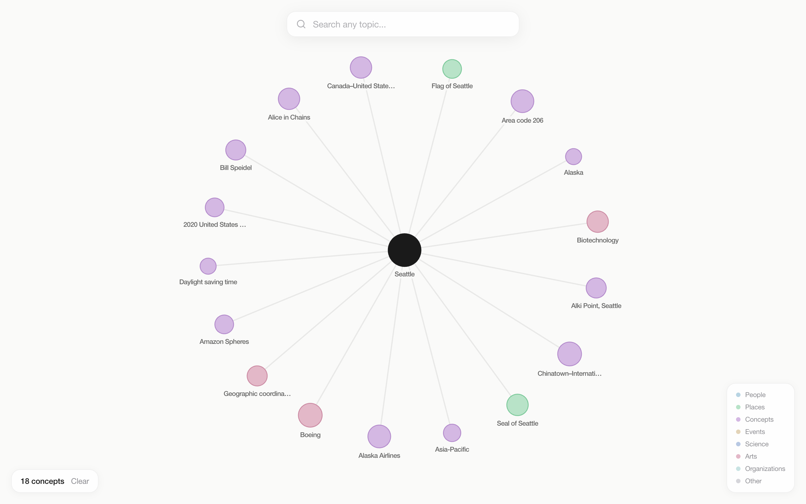
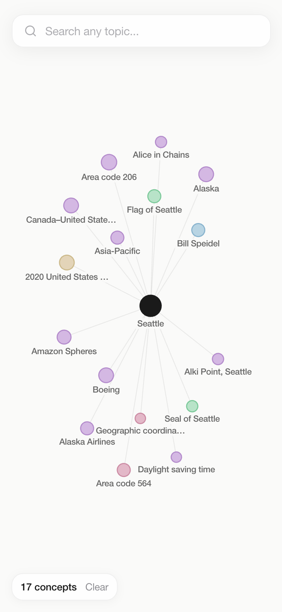

# WikiGraph

Search any topic and explore it as a force-directed graph of connected Wikipedia concepts. Built for anyone who likes falling down Wikipedia rabbit holes and wants to see the shape of one.

**Status:** Live at https://wikigraph-ochre.vercel.app · Data is live from Wikipedia on every search, nothing is cached or stored.



<table>
  <tr>
    <td width="70%"></td>
    <td width="30%"></td>
  </tr>
</table>

## What it does

- Type a topic, get a graph: the article you searched sits in the middle, the concepts its introduction links to orbit it.
- Nodes are colored by what they are (people, places, concepts, events, science, arts, organizations) so you can read the shape of a topic at a glance.
- Click a node to read its Wikipedia summary and thumbnail in a side panel, or open the article.
- Click "Expand" to pull that node's own connections into the same graph. Keep going as deep as you want.
- Hover a node to light up its neighbors and dim everything else.
- Autocomplete from Wikipedia as you type, `/` focuses search, and the URL carries `?q=` so a graph is shareable.

## How it works

A single Next.js 14 app (App Router, TypeScript, Tailwind). The browser never talks to Wikipedia for graph data; it calls my own `/api/wiki?title=...` route, which fans out to Wikipedia server-side and returns a `{ nodes, links }` payload. The only direct browser-to-Wikipedia call is the autocomplete dropdown.

For the root topic the route runs three requests in parallel: the REST summary endpoint for extract and thumbnail, the Action API `parse` endpoint restricted to `section=0` (intro only) for outgoing links, and the Action API `query` endpoint for categories. Links are filtered through a regex blacklist, then for every surviving link the route fetches a summary and categories, again in parallel. Whatever comes back becomes a depth-1 node connected to the root.

Expansion reuses the same route. The page fetches `/api/wiki` for the clicked node, drops the returned root, and merges the children into the existing graph: existing titles get a new link only, new titles become nodes one depth deeper.

```
Browser                         Next.js route (/api/wiki)                 Wikipedia
-------                         -------------------------                 ---------
SearchBar ──debounce 300ms────────────────────────────────────────────▶ action=opensearch (limit 5)
   │
   │ GET /api/wiki?title=T
   ▼
page.tsx ─────────────────────▶ fetchPageData(T)
                                  ├─ fetchSummary ──────────────────▶ rest_v1/page/summary/T
                                  ├─ fetchIntroLinks ───────────────▶ action=parse&section=0&prop=links
                                  │     └─ filterLinks (13 regexes, cap 25)
                                  └─ detectCategory ────────────────▶ action=query&prop=categories&cllimit=20
                                Promise.allSettled over each link:
                                  ├─ fetchSummary ──────────────────▶ rest_v1/page/summary/L
                                  └─ detectCategory ────────────────▶ action=query&prop=categories
   ◀──────────────────────────── { nodes, links }
   │
   ▼
Graph.tsx (react-force-graph-2d, canvas)
   ├─ nodeCanvasObject: circle + stroke + label pill
   ├─ linkCanvasObject: hairline, brighter when hovered
   └─ click ─▶ InfoPanel ─▶ Expand ─▶ GET /api/wiki?title=node ─▶ merge
```

## Craft notes

- **Intro links only.** I ask the Action API for `section=0` instead of the whole article, so the graph shows what the lead paragraph considers essential rather than every footnote. Results are capped at 25 links per page (`src/lib/filters.ts`, `maxLinks = 25`; `src/lib/wikipedia.ts`, `fetchIntroLinks`).
- **A 13-regex blacklist does most of the cleanup.** Bare years (`/^\d{1,4}$/`), ordinals like "3rd century", month names, "List of", disambiguation pages, ISO codes, `Wikipedia:`/`Category:`/`File:`/`Help:`/`Template:` namespaces, plus "United States" and "United Kingdom" because they link from nearly everything (`src/lib/filters.ts`).
- **Category detection is 6 regexes over Wikipedia's own category names.** I pull up to 20 categories (`cllimit=20`), lowercase and join them, then test in order: person, place, event, science, art, organization; anything else is "concept", and any failure also falls back to "concept" (`src/lib/wikipedia.ts`, `detectCategory`). The 8 category colors (7 detected categories plus an unused `other`) and the near-black root are defined once in `src/lib/colors.ts`; the 8 category fills and strokes are mirrored under `theme.extend.colors.node` in `tailwind.config.ts`.
- **Fan-out is wide but bounded.** One search is at most 3 + 2 x 25 = 53 Wikipedia requests in two parallel waves (the root's three, then two per surviving link), each with a 5000 ms `AbortController` timeout, and children use `Promise.allSettled` so one dead page never fails the graph (`src/lib/wikipedia.ts`, `TIMEOUT_MS`; `src/app/api/wiki/route.ts`). A `404` from Wikipedia becomes a "Topic not found" 404 from my route; everything else is a 500 with the message passed through.
- **Link strength is computed but not yet a force.** The route assigns each link a strength from 0.9 down toward 0.5 by its position in the intro (`0.9 - (index / links.length) * 0.4`), and expansion links get a flat 0.6 (`src/app/api/wiki/route.ts`; `src/app/page.tsx`). Nothing in `Graph.tsx` feeds this into `d3-force` yet; the layout uses the tuned charge, link, collide and x/y forces described below, but every link has the same pull. Wiring strength into `linkStrength` is the obvious next step.
- **Labels are rationed, not hidden.** The root and every depth-1 node always carry a label; deeper nodes only label when hovered, adjacent to the hovered node, or when zoom passes `globalScale > 1.4`. Label font is `min(12 / globalScale, 14)` px, text over 20 characters is cut to 19 plus an ellipsis, labels are skipped entirely once that size drops below 2 px, and each label sits on a translucent `rgba(250,250,249,0.85)` pill so it stays legible over links (`src/components/Graph.tsx`, `drawNode`).
- **Hover dims the world.** Hovering sets non-adjacent nodes to 30% alpha, draws links at `rgba(0,0,0,0.18)` and 1.5 px when connected versus `0.07` and 0.8 px at rest, and `0.03` when dimmed. Node hit areas are the drawn radius plus 4 units, never below a 10-unit circle, which keeps small nodes easy to grab (`src/components/Graph.tsx`, `drawLink`, `nodePointerAreaPaint`).
- **Node size encodes depth.** Every node carries a `size`: root 24, depth-1 nodes 12 to 18, depth-2 10 to 14, depth-3 and beyond 8 to 10, randomized within range (`src/app/api/wiki/route.ts`; `src/app/page.tsx`, `handleExpand`). `Graph.tsx` draws the root at radius 11 px and everything else at `size * 0.45` clamped to 4 to 8 px (+1.5 on hover), so depth-1 nodes read larger than their children. A `forceCollide` keyed to that radius keeps circles from stacking.
- **The graph fits the viewport once per search or expand.** `next/dynamic` swallows refs, so the force-graph instance ref travels in as a `forwardedRef` prop. On every new root or node-count change the component re-tunes `d3-force` (link distance 110/70/50 by depth, charge -320, and an aspect-aware `forceX`/`forceY` that stretches the cluster tall on portrait phones and wide on desktop), then calls `zoomToFit(400, padding)` once, on `onEngineStop` or a 1.5 s fallback. Manual zoom and pan are left alone afterwards.

No API keys. Wikipedia's REST and Action APIs are open; the only identification is an `Api-User-Agent: WikiGraph/1.0 (educational project)` header.

## Run locally

```bash
git clone https://github.com/sriharibs-lab/wikigraph.git
cd wikigraph
npm install
npm run dev
```

Open http://localhost:3000. There are no environment variables.

## Status / roadmap

Working end to end: search, autocomplete, graph, info panel, expand, hover, URL state, mobile bottom sheet. Deployed on Vercel.

What I would do next, roughly in order:

- Feed link `strength` into `d3-force` so intro position actually shapes the layout.
- Cache `/api/wiki` responses at the edge; the same topics get searched repeatedly.
- Dot-grid background from the spec (`docs/SPEC.md`), never built.
- Dark mode.

The original build brief is in `docs/SPEC.md`.

## License

MIT. See `LICENSE`.

Made by Srihari Srinivasa in Seattle, mostly with Claude Code.
